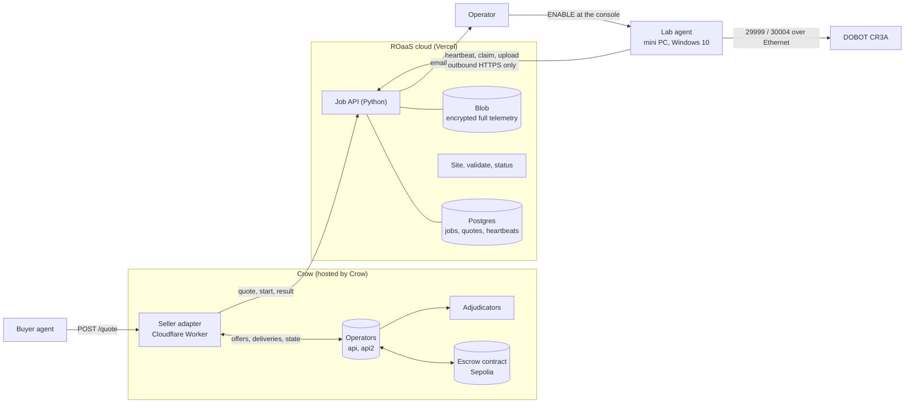
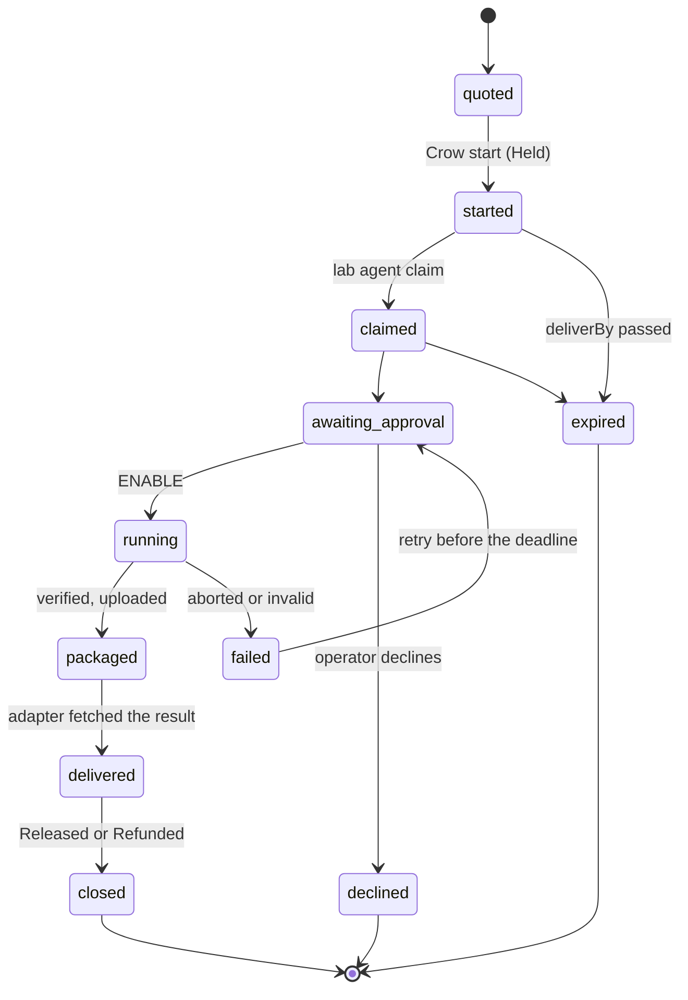

# ROaaS architecture (deliverable 2)

**Status:** proposal of 2026-11-25, waiting for approval.

**Inputs:** the project brief, [`CROW_SELLER_REPORT.md`](CROW_SELLER_REPORT.md), [`decisions.md`](decisions.md)
(D1–D17) and the open [`questions-for-crow.md`](questions-for-crow.md) (Q1–Q11).

**Assumption:** Crow hosts our seller adapter (D3, Q1). If not, section 9 lists the fallbacks; nothing else
changes.

## 1. Overview

ROaaS has three tiers. Each tier checks what it receives from the others. The lab only makes outbound
connections, and the robot moves only after local validation and local approval.



| Tier | Component | Runs on | Decides | Holds |
|---|---|---|---|---|
| **Contract and money** | Crow seller adapter | Crow's Cloudflare account (hosted seller) | Signs offers and deliveries, watches the escrow, encrypts, handles refunds | Crow selling key (secp256k1), credential for our job API |
| **Shop** | Job API, site | Vercel | Accept or refuse, price, deadline, robot online, queue, rate limits; stores results | Adapter credential (to check it), lab-agent token hash, DB/Blob/email tokens |
| **Robot** | Lab agent, robot adapters | Lab mini PC | Re-validation against **local** limits, approval, execution, recording, data signature, verification, packaging | P-256 data-signing key, serial HMAC salt, lab-agent token |

**Safety rule:** the lab never relies on the cloud for safety. A compromised cloud can queue a job, but it
cannot make the robot leave the limits stored on the mini PC, and it cannot skip the operator's approval.

## 2. Life of a Crow job

```mermaid
sequenceDiagram
  participant B as Buyer agent
  participant A as Crow adapter
  participant V as Job API (Vercel)
  participant L as Lab agent (mini PC)
  participant Op as Operator
  participant R as CR3A
  loop every 10 s
    L->>V: heartbeat (robot status) and claim
  end
  B->>A: POST /quote {buyer, scope}
  A->>V: POST /api/crow/quote {buyer, scope}
  V->>V: decode order, validate, robot ready?, queue, rate limit, estimate
  V-->>A: {price, quoteId, deliverWithinSec} or an error
  A-->>B: {commitmentId, price, fees, expiresAt}
  B->>A: funds the hold (price + adjudication fee)
  A->>V: POST /api/crow/jobs {commitmentId, quoteId, scope}
  V->>V: confirm the commitment is Held (operators' public API)
  V-->>A: {jobId}
  V->>Op: email "job waiting for approval"
  L->>V: claim, receives the job
  L->>L: re-validate against local limits, check the deadline
  Op->>L: types ENABLE (on-site policy)
  L->>R: home, waypoints, home; record at 125 Hz
  L->>L: sign, verify, build episode.json, encrypt full telemetry
  L->>V: full telemetry to Blob, then episode.json
  A->>V: GET /api/crow/jobs/{jobId}/result
  V-->>A: 200 episode.json
  A->>A: pre-runs the checks, encrypts, delivers
  Note over A: adjudicators judge: Released or Refunded
```

## 3. Components

### 3.1 Repository layout

```text
roaas/
  kits/                    reference kits v0.4.5 (unchanged)
  provider/roaas/          Python package (3.9+), used by the lab and by the job API
    core/                  task schema, limits, jobs and states, estimate, packaging, verify framework,
                           offer and check generators, canonical JSON
    robots/
      base.py              RobotAdapter protocol and data types
      dobot_cr3a/          wraps the kit (protocol, recorder, motion, verifier)
      fake/                in-process simulator for tests
    signers/               software, windows_tpm (existing); later linux_tpm, piv
    agent/                 lab agent loop, approval policies, cloud client (stdlib HTTP)
    settlement/            crow (via the job API), manual (today's email and zip flow)
    cli.py                 roaas status | open | close | pause | queue | approve | submit --manual | offers build
  provider/tests/          pytest; the fake controller on random ports
  api/                     Vercel functions (Python): job API, validate, status
  public/                  static site: offers, card, buyer guide
  crow/                    generated hosted-seller configuration (no secrets)
  docs/
```

**Why Python on Vercel:** the quote and the lab run the **same** `roaas` code for validation, estimation and
check generation, so there is one source of truth. The Vercel project's root is the repository root, with
`api/`, `public/` and a `requirements.txt` for the cloud. The lab agent depends only on `cryptography`.

### 3.2 Robot adapter interface

```python
class RobotAdapter(Protocol):
    robot_id: str                     # "dobot_cr3a"
    model: str                        # "DOBOT CR3A"

    # pure: no sockets; importable on Vercel
    def task_types(self) -> list[TaskType]: ...         # name, params schema, description
    def public_limits(self) -> dict: ...                # what we publish (lab_limits_cr3a.json)
    def validate(self, task: Task) -> Validation: ...   # errors and warnings; never clamps
    def estimate(self, task: Task) -> Estimate: ...     # motion s, recording s, preview rate, bytes
    def plan(self, task: Task) -> str: ...              # the program, readable by the operator
    def check_bounds(self) -> dict: ...                 # integer bounds per preview column, for Crow checks

    # lab only: needs the robot
    def probe(self) -> RobotStatus: ...                 # reachable, tcp_mode, mode, alarms, clock offset
    def execute(self, task: Task, approval: Approval, workdir: Path) -> Episode: ...
    def verify(self, episode: Episode, task: Task) -> list[CheckResult]: ...
    def preview(self, episode: Episode, budget_bytes: int) -> dict: ...
```

**Approval policies** share one interface, `Approval.request(job, program) -> bool`:

| Policy | Behaviour | When |
|---|---|---|
| `on-site` | Prints the program; the operator types `ENABLE` at the mini PC console. This is today's behaviour | Now (D5) |
| `auto` | Approves when the cell's interlocks report OK and the workspace check passes; the camera hook is still a placeholder | Later, after the camera and a brief revision |
| `never` | Dry run: validates and plans, never moves | Tests, demos |

The recorder starts **after** approval, with a 0.5 s pre-roll, so that the operator's waiting time is no
longer recorded.

**Signers** keep today's interface (`kind`, `description`, `public_key()`, `sign(bytes) -> DER`). The mini PC
has TPM 1.2, so it uses the software key for now. Linux TPM 2.0 (`tpm2-tools`) and a YubiKey PIV backend can
be added later without changes elsewhere.

### 3.3 Lab agent (mini PC)

- **Every 10 s** it runs `probe()`, a read-only call (`RobotMode()`, `GetErrorID()` on 29999), then sends a
  heartbeat and a claim in a single call:
  `{robot_id, ready, reason, mode, alarms, tcp_mode, on_duty, busy, kit_version, clock_offset_ms}`.
- **Ready** (D16) means: the dashboard answers (TCP mode, DobotStudio Pro not holding the robot), the robot
  is in mode 4 (disabled), and there are no alarms.
- **For each job:**
  1. re-validate against the local limits file;
  2. check the deadline: now + estimate + margin must be before `deliverBy`;
  3. approval;
  4. run;
  5. verify;
  6. package;
  7. upload;
  8. report each state change.
- **One robot lock:** one job at a time, and manual jobs take the same lock.
- **Windows:** a console process during the on-site phase; a Windows service once `auto` is enabled.

### 3.4 Job API (Vercel)

| Method | Path | Caller | Auth | Purpose |
|---|---|---|---|---|
| POST | `/api/crow/quote` | Crow adapter | Bearer (adapter credential) | Validate, check readiness, price, `deliverWithinSec` |
| POST | `/api/crow/jobs` | Crow adapter | Bearer | Start a job. Idempotent on `commitmentId`; confirms the commitment is Held before queueing |
| GET | `/api/crow/jobs/{jobId}/result` | Crow adapter | Bearer | 202 while the job runs, 200 with `episode.json` |
| POST | `/api/lab/heartbeat` | Lab agent | Lab token | Status in; the next job (with a lease) out |
| POST | `/api/lab/jobs/{jobId}/events` | Lab agent | Lab token | `approved`, `declined`, `running`, `failed`, `packaged` |
| POST | `/api/lab/jobs/{jobId}/upload-url` | Lab agent | Lab token | A Blob client-upload token for the full telemetry |
| PUT | `/api/lab/jobs/{jobId}/episode` | Lab agent | Lab token | `episode.json` (at most 1 MiB) |
| POST | `/api/validate` | Anyone | Rate-limited | Detailed reasons why an order would be refused (the adapter hides our error bodies) |
| GET | `/api/status` | Anyone | None | Robot online and ready, queue length; no job details |
| GET | `/`, `/offers`, `/card` | Anyone | None | Site, offer documentation, agent card |

- **Storage:**
  - **Postgres** (Neon, through the Vercel Marketplace): quotes, jobs, job events, the last heartbeat and
    rate-limit counters.
  - **Blob:** the encrypted full telemetry, kept for N days (placeholder).
  - Vercel functions accept at most 4.5 MB per request, so the full telemetry goes straight to Blob with a
    client-upload token.
- **Email:** sent through a transactional provider (placeholder; for example Resend) when a job is funded,
  when a job fails, and when the robot has been offline for more than X minutes while the operator is on
  duty.
- **Load:** one heartbeat-and-claim call every 10 s is about 260 000 calls per month. This must be checked
  against the plan's limits; the Hobby plan is non-commercial anyway.

### 3.5 Crow configuration (`crow/`)

`roaas offers build` generates the following from the robot adapters, `public_limits()` and `pricing.yaml`
(placeholders):

- **`seller.json`**, the hosted-seller configuration:
  - `sellerApi` (our three URLs and the name of the credential variable);
  - the scope rules;
  - `termsRules` (one per task type);
  - `timing`, `payoutAddress` and `quoteRateLimit`.
- **`template.json`**: deliverable, checks with `{{scope}}` placeholders, fee.
- **The card text and the offer pages** in `public/`.

No secrets go in the repository: Crow adds them when deploying.

## 4. Schemas

### 4.1 Task (internal, robot-agnostic)

```json
{
  "schema": "roaas-task/1",
  "robot": "dobot_cr3a",
  "task": "joint_waypoints",
  "order_id": "buyer-demo-0001",
  "nonce": "3f9a6c1e8b2d47f0a5c9e1b7d3f20864",
  "issued_at_utc": "2026-11-25T10:00:00Z",
  "params": { "speed_factor": 30, "waypoints": [[12.5, -15.0, 25.0, 30.0, -40.0, 45.0]] },
  "notes": "optional, at most 500 characters"
}
```

- **Legacy CR3A order:** a file with no `robot` or `task` field is read as `dobot_cr3a / joint_waypoints`,
  with `params` taken from its top-level fields. Its bytes are kept exactly as they are.
- **Task types for the CR3A (D11):**

| Task | Params | Program |
|---|---|---|
| `joint_waypoints` | `speed_factor` 1…`max_speed_factor`; 1–10 waypoints of 6 joint angles inside the envelope | home → waypoints → home |
| `repeatability` | `speed_factor`; 1–5 waypoints; `repetitions` 2…N (placeholder 10) | home → (waypoints) × N → home |

- **Future tasks** follow the same shape: a mobile robot `navigate`, a camera rig `capture`.

### 4.2 Crow scope (what the buyer sends)

Adapter scope fields can be only `string`, `strings` or `integer` (report, section 3), so the task travels as
text:

```json
{ "robot": "dobot_cr3a", "task": "joint_waypoints", "order": "{\"schema\":\"roaas-task/1\",...}" }
```

- **Adapter rules:**
  - `robot` must match `^dobot_cr3a$`;
  - `task` must match `^(joint_waypoints|repeatability)$`;
  - `order` must be printable ASCII of bounded length (exact rule to be set).
- **The `order` string is the order file.** Its UTF-8 bytes are what is hashed (`order_sha256`) and
  stored. The buyer keeps the same string to verify byte identity.
- Q5 asks Crow for native lists.

### 4.3 Manifest `dobot-episode/0.6` (signed)

The manifest keeps today's canonical-JSON signing. Changes from 0.5:

- **Removed:** `recorder.target_host`, `recorder.host_os`, `recorder.python` (D7).
- **Added `deal`:** `{settlement: "crow" | "manual", commitment_id, buyer, job_id}` (D8).
- **Added `task`:** `{schema, robot, task}`. The `order` section is unchanged (`order_sha256`, nonce,
  waypoints, speed).
- **Added `summary`,** computed from the data **before** signing:
  - `status`;
  - `arrivals`: `[{point, target_deg, sample, max_error_deg}]`;
  - `spec_violations`, `continuity_violations`;
  - `repetitions`, for the repeatability task.
- **Added `preview`:** `{rate_hz, columns, sha256}`, where `sha256` is the hash of the canonical preview
  JSON, so that the signature covers the preview as well.
- **Unchanged:** `files["telemetry.csv.gz"]` (the hash of the full telemetry) and `raw_recording` (raw.bin
  stays in the lab).

`verify_episode.py` stays able to read 0.5.

### 4.4 Delivery document `roaas-episode/1`

The delivery is `application/json`, at most 1 MiB. Its shape already fits the proposed `signature_valid`
check (ADR-0045):

```json
{
  "format": "roaas-episode/1",
  "manifest": { "...": "object, equal to manifest_text parsed" },
  "manifest_text": "<the exact signed bytes, canonical JSON>",
  "manifest_sig": "<base64 DER ECDSA P-256 signature>",
  "pubkey_pem": "-----BEGIN PUBLIC KEY-----\n...",
  "order_text": "<the exact order string the buyer sent>",
  "preview": {
    "rate_hz": 25,
    "t_ms": [0, 40, 80],
    "q1": [], "q2": [], "q3": [], "q4": [], "q5": [], "q6": [],
    "qd1": [], "qd2": [], "qd3": [], "qd4": [], "qd5": [], "qd6": []
  },
  "full_telemetry": {
    "url": "https://<blob store>/<id>",
    "cipher": "aes-256-gcm",
    "key": "<base64, 32 bytes>",
    "ciphertext_sha256": "<hex>",
    "bytes": 0,
    "available_until": "<ISO 8601>"
  }
}
```

- **The preview is column-major, one array per joint,** so that each joint gets its own bounds. The JSON
  Schema subset has no `prefixItems`.
- **The preview rate is the highest of 125, 50, 25 or 10 Hz** that keeps the document under 900 KB.
  Measured on the real CR3A: at 125 Hz the preview holds about 1.6 min, at 25 Hz about 8 min. The quote
  refuses tasks longer than the maximum job duration (placeholder 10 min).
- **The full telemetry** is the kit's own `telemetry.csv.gz` (its hash is in the manifest), encrypted with a
  fresh key and stored in Blob. The key reaches the buyer only inside the Crow delivery, that is only when
  the deal is released (D14).

### 4.5 Crow checks (`checks-only`, at most 10)

| # | Id | Kind | What it requires |
|---|---|---|---|
| 1 | `format` | `json_schema` | Required top-level fields, `format` const, no extra fields |
| 2 | `order` | `json_schema` | `order_text` const `"{{order}}"`: exactly the buyer's order |
| 3 | `status` | `json_schema` | `manifest.status` = `completed`; spec and continuity violations = 0 |
| 4 | `signer-key` | `json_schema` | `manifest.signer.pubkey_sha256` const = the pinned fingerprint; `manifest_sig` and `pubkey_pem` patterns |
| 5 | `arrivals` | `json_schema` | Every `max_error_deg` ≤ 1; at least 3 points (home, ≥ 1 waypoint, home) |
| 6 | `envelope` | `json_schema` | Every value of `preview.q1…q6` inside the lab envelope ± 1° (integer bounds per joint) |
| 7 | `speeds` | `json_schema` | Every value of `preview.qd1…qd6` within the datasheet limits |
| 8 | `full-telemetry` | `json_schema` | URL on our Blob domain; key and hash patterns |
| 9 | `repetitions` | `json_schema` | Added by a terms rule when `task` = `repeatability` |
| 10 | `hidden` | `hidden_characters_max` | Total 0 |

When Crow ships `signature_valid`, check 4 becomes:
`{alg: ecdsa-p256-sha256, publicKey: {pointer: /pubkey_pem, spkiSha256: <pinned>}, message: {pointer: /manifest_text, jsonEquals: /manifest}, signature: {pointer: /manifest_sig, format: der}}`.

**What the checks prove, and what they do not:**

| Proven before payment | Proven only by the buyer, offline, after release |
|---|---|
| The delivery is about exactly this order (`order_text`) | That `arrivals` really match the order's waypoints (Q11) |
| Every previewed position is inside the envelope; every previewed speed is within the limits | That the preview is a faithful subsample (its hash is in the manifest) |
| The self-reported status, violations and arrival errors are acceptable | That the full telemetry matches its hash |
| The pinned key is named (today); the key really signed it (with `signature_valid`) | The full `verify_episode.py` run |

### 4.6 Job states



Crow allows a single submission, but a run that failed in the lab can be repeated before the deadline,
because nothing was delivered yet.

## 5. Readiness, deadlines, limits

- **A quote is accepted only if all of these hold:**
  - the last heartbeat is younger than 30 s;
  - the robot is ready (D16);
  - the operator is on duty (on-site policy);
  - the provider is not paused;
  - the queue is shorter than its maximum (placeholder 3);
  - the buyer is within its rate limit (placeholder);
  - the estimated duration is at most the maximum job duration (placeholder 10 min).
- **`deliverWithinSec`:** placeholder 72 h while approval is on site; the estimate plus a margin once the
  policy is `auto`.
- **Motion timeout:** the estimate × 1.5 + 30 s, instead of the fixed 90 s.
- **Duration estimate:** a trapezoidal profile per joint, from the datasheet speeds scaled by
  `speed_factor`, calibrated on real recordings. Reference: the real arm runs the example order in 8.9 s at
  30%.
- **Operator controls:** `roaas open`, `roaas close`, `roaas pause` (on duty, off duty, paused). Funded jobs
  stay queued while the provider is paused.

## 6. Security and privacy

| Data | Lives in | Seen by |
|---|---|---|
| `raw.bin` | Mini PC only | Lab |
| Full telemetry | Blob, encrypted | Anyone with the key: adjudicators, the buyer after release, us |
| `episode.json` | Vercel, then Crow (encrypted) | Us; the three adjudicators; the buyer after release |
| Terms (order text, pinned fingerprint, price, payout address, checks) | Sepolia, public | Everyone |
| Robot serial | Never published | Only its HMAC is published |
| IP addresses, hostnames, OS | Removed from the manifest | Nobody |

| Secret | Where |
|---|---|
| Crow selling key | Crow Worker secret (testnet; production needs D6) |
| Job API credential for the adapter | Crow Worker secret and Vercel env (hash) |
| Lab-agent token | Mini PC `keys/`, plus its hash in Vercel env |
| P-256 data-signing key | Mini PC `keys/` |
| Serial HMAC salt | Mini PC environment |
| Postgres, Blob and email tokens | Vercel env |

**Defences in depth:**

- **Our API confirms with the operators that a commitment is Held before queueing it.** A leaked adapter
  credential alone therefore cannot queue a job.
- **The lab agent re-validates every job locally,** so a compromised cloud cannot move the robot beyond the
  limits stored on the mini PC.
- **A leaked lab token** allows fake heartbeats or uploads, but a fake delivery would still lack a valid
  P-256 signature.

## 7. Manual path

`roaas submit order.json --manual` puts an order in the same local queue, under the same lock and the same
approval. The output is today's zip, which the operator emails. `kits/dobot_kit/run_order.py` stays usable as
a fallback (D10).

## 8. Adding a robot

1. Create `roaas/robots/<id>/` with a `RobotAdapter`: task types, public limits, `validate`, `estimate`,
   `plan`, `probe`, `execute`, `verify`, `preview`, `check_bounds`.
2. Add a fake for tests.
3. Register the adapter.

`roaas offers build` then generates its offers and checks. Neither the core nor the job API changes.

## 9. Environments and fallbacks

- **Development (Mac):**
  - the fake robot;
  - the job API locally;
  - Crow's local simulation: `pnpm sim`, plus the Node adapter with `--sim`, pointed at the local job API.
- **Testnet:** Vercel production, Crow's hosted adapter on Sepolia, the mini PC.
- **If Crow cannot host the adapter:**
  1. the same core as our own Cloudflare Worker (`apps/hosted-sellers`);
  2. the Node adapter behind a tunnel.

  Only the location of the adapter changes.

## 10. Implementation plan

| Phase | Work | Done when |
|---|---|---|
| 3 | `roaas` core and `dobot_cr3a` adapter wrapping the kit: approval callback, recorder after approval, manifest 0.6, estimate, preview, two-level packaging; `fake` robot; manual path | pytest green against the fake controller; a v0.6 episode verifies; tampering is detected |
| 4 | Offer and check generator; the two templates | Generated deliveries pass Crow's `check-delivery.ts`, and tampered ones fail |
| 5 | Job API on Vercel, lab agent, end to end in Crow's local simulation, then Sepolia with the hosted adapter and the fake robot | One deal Released and one Refunded on testnet |
| 6 | Operator CLI (`queue`, `approve`, `decline`, `open`, `close`, `pause`) and emails | The operator can run a day of jobs from the CLI |
| 7 | Docs: provider setup (Windows, Linux), adding a robot, offer authoring, buyer guide for Crow | — |
| 8 | One real testnet job on the CR3A, with the operator present | Released, and the buyer's offline verification passes |

## 11. Open points

- Answers to Q1, Q2, Q3, Q5 and Q11 may simplify section 4.
- Vercel details, to confirm in phase 5: the Python runtime layout, Blob client uploads from Python, and
  invocation limits.
- Prices, deadlines, maximum queue length, retention days and maximum job duration are placeholders, set in
  `pricing.yaml` and `limits`.
