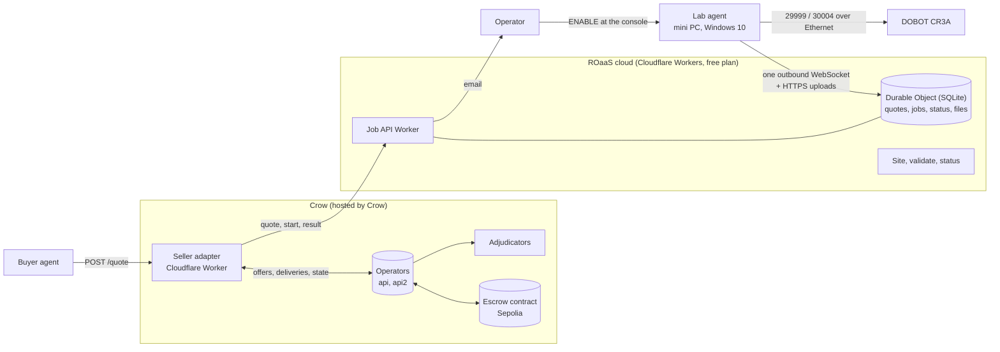
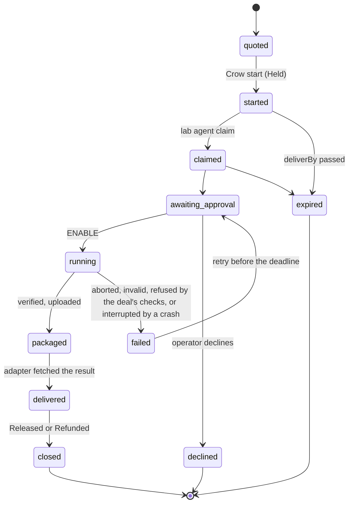

# ROaaS architecture (deliverable 2)

**Status:** proposal of 2026-11-25, waiting for approval.

**Inputs:** the project brief, [`CROW_SELLER_REPORT.md`](CROW_SELLER_REPORT.md), [`decisions.md`](decisions.md)
(D1–D17) and the open [`questions-for-crow.md`](questions-for-crow.md) (Q1–Q11).

**Assumption:** Crow hosts our seller adapter (D3, Q1). If not, section 9 lists the fallbacks; nothing else
changes.

## 1. Overview

ROaaS has three tiers. Each tier checks what it receives from the others. The lab only makes outbound
connections, and the robot moves only after local validation and local approval.



| Tier | Component | Runs on | Decides | Holds |
|---|---|---|---|---|
| **Contract and money** | Crow seller adapter | Crow's Cloudflare account (hosted seller) | Signs offers and deliveries, watches the escrow, encrypts, handles refunds | Crow selling key (secp256k1), credential for our job API |
| **Shop** | Job API, site | Cloudflare Worker + one SQLite Durable Object per robot | Accept or refuse, price, deadline, robot online, queue, rate limits; stores results | Adapter credential, lab-agent token, email key (Worker secrets) |
| **Robot** | Lab agent, robot adapters | Lab mini PC | Re-validation against **local** limits, approval, execution, recording, data signature, verification, packaging | P-256 data-signing key, serial HMAC salt, lab-agent token |

**Safety rule:** the lab never relies on the cloud for safety. A compromised cloud can queue a job, but it
cannot make the robot leave the limits stored on the mini PC, and it cannot skip the operator's approval.

## 2. Life of a Crow job

```mermaid
sequenceDiagram
  participant B as Buyer agent
  participant A as Crow adapter
  participant V as Job API (Cloudflare)
  participant L as Lab agent (mini PC)
  participant Op as Operator
  participant R as CR3A
  L->>V: opens one WebSocket (outbound), then robot status every 10 s
  B->>A: POST /quote {buyer, scope}
  A->>V: POST /api/crow/quote {buyer, scope}
  V->>V: scope consistent? robot online and ready? queue, rate limit
  V->>L: validate (over the WebSocket)
  L-->>V: errors or estimate (the lab's own Python rules)
  V-->>A: {price, quoteId, deliverWithinSec} or an error
  A-->>B: {commitmentId, price, fees, expiresAt}
  B->>A: funds the hold (price + adjudication fee)
  A->>V: POST /api/crow/jobs {commitmentId, quoteId, scope}
  V->>V: from the operators: Held, deliverBy, buyer, terms name this order
  V-->>A: {jobId}
  V->>Op: email "job waiting for approval"
  V->>L: the job (over the WebSocket)
  L->>L: re-validate against local limits, check the deadline
  Op->>L: types ENABLE (on-site policy)
  L->>R: home, waypoints, home; record at 125 Hz
  L->>L: sign, verify, build episode.json, encrypt full telemetry
  L->>V: PUT encrypted telemetry, then PUT episode.json (HTTPS)
  A->>V: GET /api/crow/jobs/{jobId}/result
  V-->>A: 200 episode.json
  A->>A: pre-runs the checks, encrypts, delivers
  Note over A: adjudicators judge: Released or Refunded
```

## 3. Components

### 3.1 Repository layout

```text
roaas/
  kits/                    reference kits v0.4.5 (unchanged)
  provider/roaas/          Python package (3.9+), used by the lab and by the job API
    core/                  task schema, limits, jobs and states, estimate, packaging, verify framework,
                           offer and check generators, canonical JSON
    robots/
      base.py              RobotAdapter protocol and data types
      dobot_cr3a/          wraps the kit (protocol, recorder, motion, verifier)
      fake/                in-process simulator for tests
    signers/               software, windows_tpm (existing); later linux_tpm, piv
    agent/                 lab agent loop, approval policies, cloud client (stdlib HTTP)
    settlement/            crow terms and the deal's checks run in the lab (crow_terms, crow_checks), manual (email and zip)
    cli.py                 roaas status | open | close | pause | queue | approve | submit --manual | offers build
  provider/tests/          pytest; the fake controller on random ports
  cloud/                   Cloudflare Worker (TypeScript): job API, Durable Object `Lab`, static site in cloud/public
  scripts/                 crow_sim_rehearsal.py: a full deal on Crow's local simulator
  crow/                    generated hosted-seller configuration (no secrets)
  docs/
```

**Where the rules live:** robot validation and estimates exist once, in Python (`roaas`). The Worker asks the
lab agent to validate each quote over its WebSocket, so a quote can only succeed while the lab is online,
which is the "robot online" rule. The Worker itself checks only that the scope is consistent (hash, nonce,
task, robot) and computes the price from `crow/pricing.json`.

### 3.2 Robot adapter interface

```python
class RobotAdapter(Protocol):
    robot_id: str                     # "dobot_cr3a"
    model: str                        # "DOBOT CR3A"

    # pure: no sockets; run by the lab agent to answer quote validations
    def task_types(self) -> list[TaskType]: ...         # name, params schema, description
    def public_limits(self) -> dict: ...                # what we publish (lab_limits_cr3a.json)
    def validate(self, task: Task) -> Validation: ...   # errors and warnings; never clamps
    def estimate(self, task: Task) -> Estimate: ...     # motion s, recording s, preview rate, bytes
    def plan(self, task: Task) -> str: ...              # the program, readable by the operator
    def check_bounds(self) -> dict: ...                 # integer bounds per preview column, for Crow checks

    # lab only: needs the robot
    def probe(self) -> RobotStatus: ...                 # reachable, tcp_mode, mode, alarms, clock offset
    def execute(self, task: Task, approval: Approval, workdir: Path) -> Episode: ...
    def verify(self, episode: Episode, task: Task) -> list[CheckResult]: ...
    def preview(self, episode: Episode, budget_bytes: int) -> dict: ...
```

**Approval policies** share one interface, `Approval.request(job, program) -> bool`:

| Policy | Behaviour | When |
|---|---|---|
| `on-site` | Prints the job and its program; the operator types `ENABLE <job code>` at the mini PC console, or `DECLINE`, or leaves it waiting (D21) | Now (D5) |
| `auto` | Approves when the cell's interlocks report OK and the workspace check passes; the camera hook is still a placeholder | Later, after the camera and a brief revision |
| `never` | Dry run: validates and plans, never moves | Tests, demos |

The recorder starts **after** approval, with a 0.5 s pre-roll, so that the operator's waiting time is no
longer recorded.

**Signers** keep today's interface (`kind`, `description`, `public_key()`, `sign(bytes) -> DER`). The mini PC
has TPM 1.2, so it uses the software key for now. Linux TPM 2.0 (`tpm2-tools`) and a YubiKey PIV backend can
be added later without changes elsewhere.

### 3.3 Lab agent (mini PC)

`roaas agent --cloud https://<worker> --robot-info robot_info_cr3a.json --host 192.168.5.1 --live`, with the
token in the `ROAAS_LAB_TOKEN` environment variable.

- **One outbound WebSocket** to `/api/lab/ws`, with a bearer token. It reconnects with backoff. Messages:
  - cloud → lab: `validate {id, order_text}`, `job {job}`;
  - lab → cloud: `hello`/`status {ready, reason, on_duty, busy, job_id}` (status every 10 s, from a read-only
    `probe()`), `validate_result`, `job_event {state}`.
- **Ready** (D16) means: the dashboard answers (TCP mode, DobotStudio Pro not holding the robot), the robot is
  in mode 4 (disabled), and there are no alarms.
- **For each job:**
  1. re-validate against the public **and** the local limits;
  2. read the deal's terms **from Crow's operators** (`GET /v1/commitments/<id>/terms`, every operator that
     answers must agree), not from the cloud. Decline the job if the terms do not name this order
     (`orderSha256`), or do not suit the robot this agent drives: rehearsal terms need the simulator, production
     terms the real robot (`--live` is refused on `127.0.0.1`);
  3. check the deadline: the estimate plus 10 min must end before `deliverBy`;
  4. approval: on site, `ENABLE <code>` typed at the console. Keys typed before the prompt appeared are
     discarded;
  5. check the deadline **again**, since the operator may answer hours later; only then start the recorder;
  6. run;
  7. verify the episode;
  8. build `roaas-episode/1` and run **the deal's own checks** on it (`roaas.settlement.crow_checks`, a port of
     the kinds our templates use, compared with Crow's code in the tests). A delivery Crow would refuse is not
     uploaded: the job fails and can be retried, and the order is not used up;
  9. `PUT /api/lab/jobs/<id>/telemetry`, then `PUT …/episode`.
- **One robot lock and one worker:** one job at a time, and the status probe never touches the dashboard while
  a job runs.
- **Crash or restart:** the agent's `hello` names the job in hand (`job_id`). The Durable Object turns any
  other `running` job into `failed` ("interrupted"), and on reconnect it sends again only jobs that never
  reached the robot. An interrupted job runs again only on `roaas ops retry`.
- **Dependencies:** `cryptography` and `websockets`.

### 3.4 Job API (Cloudflare Worker + Durable Object)

| Method | Path | Caller | Auth | Purpose |
|---|---|---|---|---|
| POST | `/api/crow/quote` | Crow adapter | `X-ROaaS-Key` | Scope consistency, robot online, queue, rate limit, lab validation, price |
| POST | `/api/crow/jobs` | Crow adapter | `X-ROaaS-Key` | Start. Idempotent on `commitmentId`. Requires Held on every operator and terms that name the quoted order; reads `deliverBy` and the buyer |
| GET | `/api/crow/jobs/{jobId}/result` | Crow adapter | `X-ROaaS-Key` | 202 while the job runs, 200 with `episode.json` |
| GET (WebSocket) | `/api/lab/ws` | Lab agent | Bearer lab token | Status, validations, jobs |
| PUT | `/api/lab/jobs/{jobId}/telemetry` | Lab agent | Bearer lab token | Encrypted full telemetry (at most 100 MB) |
| PUT | `/api/lab/jobs/{jobId}/episode` | Lab agent | Bearer lab token | `episode.json`: refused unless it names this deal, this order and the uploaded telemetry |
| GET | `/api/lab/jobs` | Operator | Bearer lab token | The last 50 jobs |
| GET | `/t/{jobId}.enc` | Anyone (the buyer) | None | Encrypted full telemetry: useless without the key from the delivery |
| POST | `/api/validate` | Anyone | None | Detailed reasons why an order would be refused (the adapter hides our error bodies) |
| GET | `/api/status`, `/api/offers` | Anyone | None | Robot online, accepting, queue; offer catalogue |
| GET | `/` | Anyone | None | Static site (`cloud/public`) |

- **Storage:** the Durable Object's SQLite holds quotes, jobs, events, status, and files in 1 MB chunks. A
  daily alarm deletes files after `RETENTION_DAYS` (30). No R2.
- **Free plan:** SQLite Durable Objects; idle hibernating objects are not billed; request bodies up to
  100 MB; 50 subrequests per invocation (we make at most 3, to the operators).
- **Email:** Resend, if `RESEND_API_KEY` and `NOTIFY_TO` are set (a job is funded, a job fails); otherwise a
  log line.

### 3.5 Crow configuration (`crow/`)

`roaas offers build` generates the following from the robot adapters, `public_limits()` and `pricing.yaml`
(placeholders):

- **`seller.json`**, the hosted-seller configuration:
  - `sellerApi` (our three URLs and the name of the credential variable);
  - the scope rules;
  - `termsRules` (one per task type);
  - `timing`, `payoutAddress` and `quoteRateLimit`.
- **`template.json`**: deliverable, checks with `{{scope}}` placeholders, fee.
- **The card text and the offer pages** in `public/`.

No secrets go in the repository: Crow adds them when deploying.

## 4. Schemas

### 4.1 Task (internal, robot-agnostic)

```json
{
  "schema": "roaas-task/1",
  "robot": "dobot_cr3a",
  "task": "joint_waypoints",
  "order_id": "buyer-demo-0001",
  "nonce": "3f9a6c1e8b2d47f0a5c9e1b7d3f20864",
  "issued_at_utc": "2026-11-25T10:00:00Z",
  "params": { "speed_factor": 30, "waypoints": [[12.5, -15.0, 25.0, 30.0, -40.0, 45.0]] },
  "notes": "optional, at most 500 characters"
}
```

- **Legacy CR3A order:** a file with no `robot` or `task` field is read as `dobot_cr3a / joint_waypoints`,
  with `params` taken from its top-level fields. Its bytes are kept exactly as they are.
- **Task types for the CR3A (D11):**

| Task | Params | Program |
|---|---|---|
| `joint_waypoints` | `speed_factor` 1…`max_speed_factor`; 1–10 waypoints of 6 joint angles inside the envelope | home → waypoints → home |
| `repeatability` | `speed_factor`; 1–5 waypoints; `repetitions` 2…N (placeholder 10) | home → (waypoints) × N → home |

- **Future tasks** follow the same shape: a mobile robot `navigate`, a camera rig `capture`.

### 4.2 Crow scope (what the buyer sends)

Adapter scope fields can be only `string`, `strings` or `integer` (report, section 3), so the task travels as
text:

```json
{ "robot": "dobot_cr3a", "task": "joint_waypoints", "order": "{\"schema\":\"roaas-task/1\",...}" }
```

- **Adapter rules:**
  - `robot` must match `^dobot_cr3a$`;
  - `task` must match `^(joint_waypoints|repeatability)$`;
  - `order` must be printable ASCII of bounded length (exact rule to be set).
- **The `order` string is the order file.** Its UTF-8 bytes are what is hashed (`order_sha256`) and
  stored. The buyer keeps the same string to verify byte identity.
- Q5 asks Crow for native lists.

### 4.3 Manifest `dobot-episode/0.6` (signed)

The manifest keeps today's canonical-JSON signing. Changes from 0.5 (implemented in phase 3, revised in
phase 4):

- **Removed:** `recorder.target_host`, `recorder.host_os`, `recorder.python` (D7).
- **Added `recorder.simulator`:** `true` when the robot was on the lab PC itself, i.e. the fake controller.
  It replaces `target_host` in Crow's "not a simulator" check (Q12).
- **Added `deal`:** `{settlement: "crow" | "manual", commitment_id, buyer, job_id}` (D8).
- **Added `task`:** `{robot, task, legacy_order, params}`. The `order` section is unchanged (`order_sha256`,
  nonce, waypoints, speed).
- **Added `program.targets_deg`:** every target in order, the homes included.
- **Added `summary`,** computed from the data **before** signing:
  - `status`, `all_ok`;
  - `arrivals`: `[{point, target_deg, reached, sample, t_ms, max_error_deg}]`;
  - `spec_violations`, `continuity_violations`;
  - `checks`.
- **Added `preview`: the checkable preview, inside the signed manifest.** It holds integer series, one per
  axis: `t_ms`, `q1_mdeg…q6_mdeg`, `qd1_mdeg_s…qd6_mdeg_s`.
  - It contains every `step`-th sample, plus every arrival sample and the last one. `source_samples` lists
    the indices in the full telemetry.
  - Crow's series checks read only integers. Its `signature_valid` check with `jsonEquals: /manifest` ties
    exactly the object those checks read to the lab's key. A hash would not tie them: per Crow's docs, no
    check kind hashes a field.
  - The rate is the highest of 125, 62.5, 25, ~10.4 and 5 Hz that fits a 440 KB budget. The preview
    travels twice, as signed text and as the object.
- **Unchanged:** `files["telemetry.csv.gz"]` (the hash of the full telemetry), `raw_recording` (raw.bin stays
  in the lab), `stats`, `program`.

`verify_episode.py` from the kit still accepts 0.6 episodes. With a new-format order it can check `--nonce`
only. Our verifier also recomputes the preview from the full telemetry (`preview-matches-telemetry`).

### 4.4 Delivery document `roaas-episode/1`

The delivery is `application/json`, at most 1 MB:

```json
{
  "format": "roaas-episode/1",
  "manifest": { "...": "object, equal to manifest_text parsed; holds summary and preview" },
  "manifest_text": "<the exact signed bytes, canonical JSON>",
  "manifest_sig": "<base64 DER ECDSA P-256 signature>",
  "pubkey_spki_b64": "<base64 DER SubjectPublicKeyInfo>",
  "order_text": "<the exact order string the buyer sent>",
  "full_telemetry": {
    "url": "https://<blob store>/<id>",
    "cipher": "aes-256-gcm:iv12|ciphertext|tag16",
    "key": "<base64, 32 bytes>",
    "ciphertext_sha256": "<hex>",
    "bytes": 123456,
    "plaintext": "telemetry.csv.gz",
    "available_until": "<YYYY-MM-DD, today + 30 days by default>"
  }
}
```

- **The full telemetry** is the kit's own `telemetry.csv.gz` (its hash is in the manifest), encrypted with a
  fresh key and stored by us. The key reaches the buyer only inside the Crow delivery, that is only when the
  deal is released (D14).
- **The buyer can rebuild** the kit-style episode folder from the document and the decrypted telemetry
  (`reconstruct_episode_dir`), and run `roaas verify-delivery` or the kit's `verify_episode.py`.

### 4.5 Crow checks (`checks-only`, 11 of the 20 allowed)

The checks are generated by `roaas offers build` (`crow/template.json`). They were tested on 2026-11-25 with
Crow's own `check-delivery.ts` (the adjudicator's first stage, at commit `423ffcd`) and `check-terms.ts`.

| # | Id | Kind | What it requires |
|---|---|---|---|
| 1 | `format` | `json_schema` | Exact top-level fields (no others); the format constant; patterns for the signature, the key and the `full_telemetry` link (https), key and hash |
| 2 | `order-text` | `json_schema` | `order_text` const `"{{orderText}}"`: exactly the buyer's order |
| 3 | `manifest-signature` | `signature_valid` | ECDSA P-256 over `/manifest_text`, key `/pubkey_spki_b64` pinned by its fingerprint, `jsonEquals: /manifest` |
| 4 | `order` | `json_schema` | Signed `order.nonce` = `{{nonce}}`, `order.order_sha256` = `{{orderSha256}}`, `task.robot` and `task.task` = `{{task}}` |
| 5 | `run` | `json_schema` | Signed schema 0.6; status completed; not record-only; `recorder.simulator` = false (true for rehearsal terms); signer fingerprint; `summary.all_ok`; no datasheet or continuity violation |
| 6 | `arrivals` | `json_schema` | Every program target reached, error ≤ 1° |
| 7 | `samples` | `json_schema` | Full recording between 1 s and the maximum duration at 125 Hz |
| 8 | `preview-bounds` | `json_schema` | Every previewed position inside the envelope ± 1° and every speed within the datasheet, **per joint**, in integer units |
| 9 | `preview-lengths` | `equal_lengths` | The 13 series have the same length |
| 10 | `preview-time` | `monotonic_column` | Time strictly increasing; no gap over 500 ms |
| 11 | `hidden` | `hidden_characters_max` | Total 0 |

Measured with Crow's code:
- **Rehearsal terms:** a fake-robot delivery is accepted, with all 11 checks passing.
- **Production terms:** the same delivery is rejected on `run` (`recorder.simulator`).
- **Tampering:** a changed preview value, an edited signed text, another order, another key, a non-https
  link, an extra field and terms for another nonce are each rejected, by the right check.

**What the checks prove, and what they do not:**

| Proven before payment (by Crow's adjudicators) | Proven only by the buyer, offline, after release |
|---|---|
| The lab's pinned key signed the manifest, and the manifest shown is the signed one | That the signed data are true (a key holder could sign made-up data) |
| The delivery is about exactly this order (text, nonce, hash) | That each arrival's target is the order's waypoint (needs `passes_through` with per-deal waypoints: Q11) |
| Not a simulator run; completed; every target reached within 1°; no violations (self-declared, signed) | That the preview is a faithful subsample (`preview-matches-telemetry`) |
| The signed preview stays in the envelope and the speed limits, per joint, with ordered time and no long gap | That the full telemetry matches its signed hash, plus every check of the kit's verifier |

### 4.6 Job states



Crow allows a single submission, but a run that failed in the lab can be repeated before the deadline,
because nothing was delivered yet.

## 5. Readiness, deadlines, limits

- **A quote is accepted only if all of these hold:**
  - the last heartbeat is younger than 30 s;
  - the robot is ready (D16);
  - the operator is on duty (on-site policy);
  - the provider is not paused;
  - the queue is shorter than its maximum (placeholder 3);
  - the buyer is within its rate limit (placeholder);
  - the estimated duration is at most the maximum job duration (placeholder 10 min).
- **`deliverWithinSec`:** placeholder 72 h while approval is on site; the estimate plus a margin once the
  policy is `auto`. In every case it must be **above 7200 s**: the operators refuse 7200 s or less (D18).
- **Motion timeout:** the estimate × 1.5 + 30 s, instead of the fixed 90 s.
- **Duration estimate:** a trapezoidal profile per joint, from the datasheet speeds scaled by
  `speed_factor`, calibrated on real recordings. Reference: the real arm runs the example order in 8.9 s at
  30%.
- **Operator controls:** `roaas open`, `roaas close`, `roaas pause` (on duty, off duty, paused). Funded jobs
  stay queued while the provider is paused.

## 6. Security and privacy

| Data | Lives in | Seen by |
|---|---|---|
| `raw.bin` | Mini PC only | Lab |
| Full telemetry | Durable Object SQLite, encrypted | Anyone with the key: adjudicators, the buyer after release, us |
| `episode.json` | Durable Object, then Crow (encrypted) | Us; the three adjudicators; the buyer after release |
| Terms (order text, pinned fingerprint, price, payout address, checks) | Sepolia, public | Everyone |
| Robot serial | Never published | Only its HMAC is published |
| IP addresses, hostnames, OS | Removed from the manifest | Nobody |

| Secret | Where |
|---|---|
| Crow selling key | Crow Worker secret (testnet; production needs D6) |
| Job API credential for the adapter | Crow Worker secret and our Worker secret `ADAPTER_KEY` |
| Lab-agent token | Mini PC environment (`ROAAS_LAB_TOKEN`), and our Worker secret `LAB_TOKEN` |
| P-256 data-signing key | Mini PC `keys/` |
| Serial HMAC salt | Mini PC environment |
| Email key | Our Worker secret `RESEND_API_KEY` |

**Defences in depth:**

- **Our API confirms with the operators that a commitment is Held before queueing it.** A leaked adapter
  credential alone therefore cannot queue a job.
- **The lab agent re-validates every job locally,** so a compromised cloud cannot move the robot beyond the
  limits stored on the mini PC.
- **A leaked lab token** allows fake heartbeats or uploads, but a fake delivery would still lack a valid
  P-256 signature.

## 7. Manual path

`roaas submit order.json --manual` puts an order in the same local queue, under the same lock and the same
approval. The output is today's zip, which the operator emails. `kits/dobot_kit/run_order.py` stays usable as
a fallback (D10).

## 8. Adding a robot

1. Create `roaas/robots/<id>/` with a `RobotAdapter`: task types, public limits, `validate`, `estimate`,
   `plan`, `probe`, `execute`, `verify`, `preview`, `check_bounds`.
2. Add a fake for tests.
3. Register the adapter.

`roaas offers build` then generates its offers and checks. Neither the core nor the job API changes.

## 9. Environments and fallbacks

- **Development (Mac):**
  - the fake robot;
  - the job API locally;
  - Crow's local simulation: `pnpm sim`, plus the Node adapter with `--sim`, pointed at the local job API.
- **Testnet:** our Worker on `*.workers.dev`, Crow's hosted adapter on Sepolia, the mini PC.
- **If Crow cannot host the adapter:**
  1. the same core as our own Cloudflare Worker (`apps/hosted-sellers`);
  2. the Node adapter behind a tunnel.

  Only the location of the adapter changes.

## 10. Implementation plan

| Phase | Work | Done when |
|---|---|---|
| 3 ✅ | `roaas` core and `dobot_cr3a` adapter wrapping the kit: approval callback, recorder after approval, manifest 0.6, estimate, preview, two-level packaging; `fake` robot; manual path | pytest green against the fake controller; a v0.6 episode verifies; tampering is detected |
| 4 ✅ | Offer and check generator; the two templates | Generated deliveries pass Crow's `check-delivery.ts`, and tampered ones fail |
| 5 🟡 | Job API on Cloudflare, lab agent, end to end in Crow's local simulation ✅ (Released, 2026-11-25; again with the lab-side safety guards of D22, 2026-11-26), then Sepolia with the hosted adapter | One deal Released on testnet |
| 6 ✅ | Operator CLI (`roaas ops status`, `queue`, `open`, `close`, `pause`, `resume`, `retry`, `decline`), per-job approval code, emails | The operator can run a day of jobs from the CLI |
| 7 | Docs: provider setup (Windows, Linux), adding a robot, offer authoring, buyer guide for Crow | — |
| 8 | One real testnet job on the CR3A, with the operator present | Released, and the buyer's offline verification passes |

## 11. Open points

- Answers to Q1, Q2, Q3, Q5 and Q11 may simplify section 4.
- Cloudflare: deployed from the lab's own account on 2026-11-26, `https://roaas.roaas-cloud.workers.dev`
  (`docs/setup/cloudflare.md`).
- Prices, deadlines, maximum queue length, retention days and maximum job duration are placeholders, set in
  `pricing.yaml` and `limits`.
